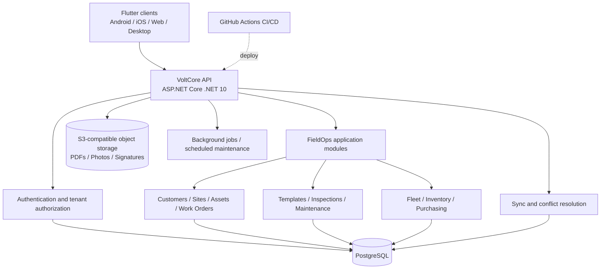
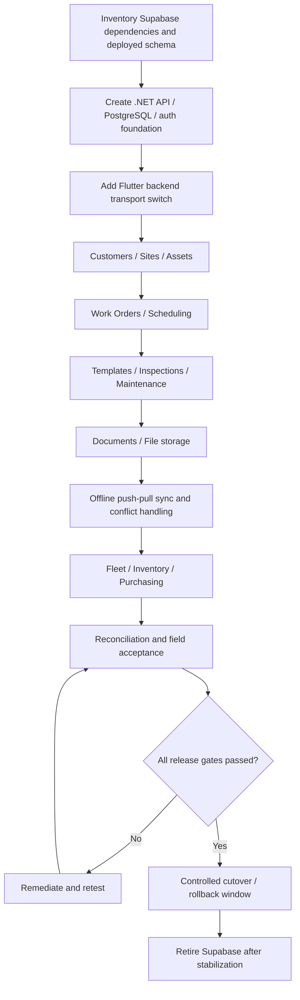
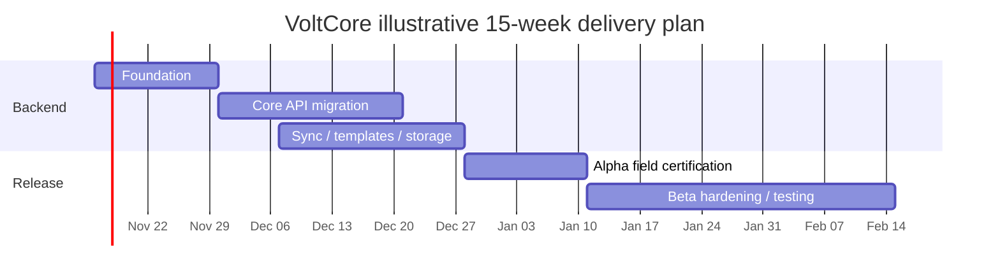
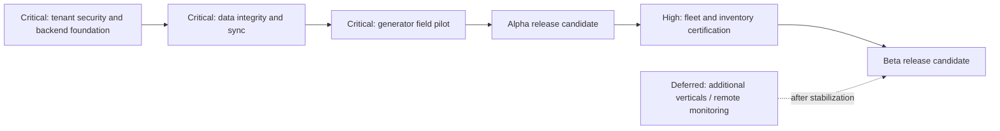

# VoltCore — Alpha/Beta Readiness Assessment and Backend Migration Plan

**Assessment date:** November 9, 2026  
**Repository:** https://github.com/devartblake/volt_core  
**Default branch:** `main`  
**Reviewed HEAD:** `5fb2dffdccd908315e49a9901008651f9959a716`  
**Audience:** A&S Electric / VoltCore engineering and project stakeholders

> **Executive conclusion:** VoltCore has a substantial offline-first Flutter Alpha foundation, but a full Alpha or Beta release has not yet been certified. The primary release blockers are live field validation, reliable backend ownership, synchronization/data integrity, database migration validation, and cross-device evidence handling. Adopt a dedicated ASP.NET Core + PostgreSQL backend incrementally rather than rewriting the Flutter client.

## 1. Repository snapshot

| Indicator | Verified status on November 9, 2026 |
|---|---|
| Default branch | `main` |
| HEAD | `5fb2dff` |
| Open pull requests | 1 — [#78](https://github.com/devartblake/volt_core/pull/78) |
| Open issues | 1 — [#77](https://github.com/devartblake/volt_core/issues/77) |
| Latest standard CI | Passed — [run 42607105312](https://github.com/devartblake/volt_core/actions/runs/42607105312) |
| Latest Phase 3 pilot certification workflow | Passed — [run 42607049774](https://github.com/devartblake/volt_core/actions/runs/42607049774) |
| Flutter package version | `0.9.0+1` in `pubspec.yaml` |
| Backend currently wired to Flutter | Supabase Auth, Postgres Data API/RPC, and Storage |
| Independent production API | Not established in the inspected repository |
| Live Phase 3 field signoff | Pending — issue #77 |

### Release status matrix

| Workstream | Implementation status | Remaining release gate |
|---|---|---|
| Flutter cross-platform foundation | Implemented | Device/platform acceptance testing |
| Customers, sites, assets | Implemented | Real tenant and cross-device verification |
| Work orders and scheduling | Implemented | Field rollout validation |
| Offline persistence and durable outbox | Implemented | Conflict, replay and end-to-end convergence certification |
| Versioned templates | Implemented | Live generator pilot |
| Generator inspections and maintenance | Implemented | Offline-to-online field signoff |
| PDFs and document evidence | Implemented | Cross-device availability and parity |
| Tenant access control | Implemented through Supabase | Backend authorization replacement and security tests |
| Fleet management | Partial, with open PR #78 | Mergeability, migrations, device testing |
| Inventory and purchasing | Work documented; maturity varies | Ledger correctness, access control, deployed-code verification |
| Dedicated backend | Proposed | Build, deploy, migrate, certify |
| Alpha/Beta release | Not certified | Acceptance criteria below |

**Interpretation:** "Implemented" describes code/documented functionality, not production certification. There is no defensible overall completion percentage from the available evidence.

## 2. Key engineering developments

### Phase 3 generator pilot

Merged PRs #71–#76 established technician launch, draft resume, durable report links, report categorization, and automated lifecycle certification. The automated certification covers local autosave, simulated restart, revision pinning, completion immutability, PDF generation and rollback behavior.

**Outstanding:** [Issue #77](https://github.com/devartblake/volt_core/issues/77) requires an actual A&S Electric technician to run inspection and maintenance workflows on a device: start online, work offline, restart, resume, complete, generate PDF, reconnect, verify server records/files, compare legacy PDF parity, and test feature-flag rollback.

### Fleet expansion

[PR #78](https://github.com/devartblake/volt_core/pull/78) adds signed asset receipts, permissions and site check-in. Its description reports 496/496 tests passing, but the PR is **open and not mergeable**. It identifies five database migrations that were not executed in its authoring environment; do not assume their live deployment state from the PR description. The receipt disclaimer must also be checked against the original paper document before collecting signatures. iOS pod installation and location-related store disclosures need validation.

### Additional work noted in repository documents

`docs/remaining_tasks.md` describes generator fleet readiness, parts and purchasing, inspection completion constraints, profile approvals and synchronization improvements. However, it is marked **November 10, 2026** (one day later than this assessment), and explicitly says some changes were not pushed. Treat these entries as a working backlog rather than proof of deployed functionality. Verify commit inclusion, migration history and actual database state before release.

Important documented risks:

- Technician stock movements can bypass intended truck ownership checks if the server does not enforce them.
- Editing or removing consumed material may not correctly reverse/update inventory ledger entries.
- Vehicle inspection photo/signature paths may only work on the original device.
- Last-write-wins or quietly skipped stale writes can lose edits without a conflict resolution workflow.
- Several tablet layouts and workflows remain untested on physical devices.
- Some tenant policies and callable security-definer database functions need authorization review.
- An additional foreign-key indexing migration is recorded as pending.

## 3. Proposed architecture

Use **ASP.NET Core (.NET 10), PostgreSQL, and S3-compatible object storage**, with Docker-based deployment to Linode and GitHub-hosted CI. Begin as a modular monolith, not a distributed microservice system.



### Stack and rationale

| Component | Recommendation | Rationale |
|---|---|---|
| API | ASP.NET Core .NET 10 | Typed contracts, policy enforcement, testability |
| Persistence | PostgreSQL | Reuse relational model, UUIDs, constraints and history |
| Data access | EF Core; Dapper for selective queries | Migrations and transaction handling |
| Identity | ASP.NET Core Identity or dedicated OIDC provider | Replace Supabase Auth with server-controlled identity |
| Authorization | Tenant-aware policies in API and database constraints | Never rely on Flutter route roles for enforcement |
| Object storage | Linode Object Storage / S3 API | Durable evidence and signed download/upload workflows |
| Background jobs | Hangfire | Retryable processing and scheduled work |
| Cache | Redis only if justified | Avoid unnecessary Alpha infrastructure |
| API contract | OpenAPI/Swagger | Generate/validate Flutter-facing contracts |
| Hosting | Linode, Docker Compose initially | Operational simplicity |
| CI/CD | GitHub Actions | Automated build/test/deploy gates |

### What to retain

Keep the Flutter UI, navigation, domain models, Hive local persistence, durable outbox, template renderer, PDFs, and existing UUIDs and historical revisions. Replace Supabase-specific datasources, auth/session handling, RPCs, storage transport and synchronization adapters behind repository interfaces.

### Important Supabase replacement scope

PostgreSQL migration alone is insufficient. Inventory every Supabase table, RLS policy, RPC, trigger, storage bucket/policy, auth identity, and Flutter datasource. Reimplement business and authorization guarantees in the new backend, including template immutability, audit events, transaction boundaries and evidence retention.

## 4. Backend API surface

```text
/api/v1/auth
/api/v1/tenants
/api/v1/users
/api/v1/customers
/api/v1/sites
/api/v1/assets
/api/v1/work-orders
/api/v1/schedules
/api/v1/inspections
/api/v1/maintenance
/api/v1/templates
/api/v1/responses
/api/v1/documents
/api/v1/fleet
/api/v1/inventory
/api/v1/sync
/api/v1/integrations/busybusy
```

The `/api/v1/sync` contract must provide idempotent operation IDs, explicit per-operation acknowledgement, server-side entity versions, incremental pull cursors, conflict responses, tenant validation, durable upload references and replay-safe retry behavior. Avoid silent overwrite/skip semantics for business-critical records. Use optimistic concurrency and transactional stock movements.

## 5. Incremental migration plan



1. **Foundation:** Stand up an independent backend repository and staging environment with health checks, migrations, OpenAPI, logs, backup/restore and tenant-aware authentication.
2. **Core operations:** Move customers, sites, assets, work orders and scheduling with API-backed Flutter adapters.
3. **Generator workflows:** Migrate template revisions, responses, inspections and maintenance while preserving exact revision IDs and immutable completion.
4. **Evidence:** Move PDFs, photos and signatures to durable object storage with tenant-bound access and checksums.
5. **Sync:** Preserve the Hive queue but migrate its delivery to explicit push/pull APIs. Plan for legacy queued operations and mixed-version clients.
6. **Operations:** Add fleet, inventory, purchase orders and BusyBusy only after required API capability is confirmed.
7. **Cutover:** Compare record counts, keys, revisions, hashes and permissions; exercise rollback and monitor after release.

**No big-bang cutover.** Supabase remains available during the compatibility and reconciliation period. Do not deploy two independent writable backends without a controlled authority and replication strategy.

## 6. Delivery schedule (four developers; planning estimate)

| Stage | Estimated duration | Main output |
|---|---|---|
| Backend foundation | 1–2 weeks | API, PostgreSQL, identity, staging, CI |
| Core API migration | 2–3 weeks | Customer/asset/work-order/inspection APIs |
| Sync, templates and storage | 2–3 weeks | Offline sync, files, historical revisions |
| Alpha certification | 1–2 weeks | Real field pilot and blocker remediation |
| Beta preparation | 2–3 weeks | Operational hardening and expanded testing |

**Estimated elapsed time with overlapping streams:** controlled Alpha **6–10 weeks**; limited Beta **10–15 weeks** from migration kickoff. These are indicative, not contractual commitments. Full Phase 4–6 scope is excluded.

### Illustrative schedule chart

The following Gantt shows one plausible overlapping **15-week** schedule. Bars are planning assumptions, not actual GitHub completion data.



*The dates are illustrative and assume a November 16, 2026 kickoff. Dependencies, staffing and holiday availability may shift the schedule.*

### Delivery priority chart



## 7. Alpha and Beta acceptance gates

| Acceptance gate | Controlled Alpha | Limited Beta |
|---|---|---|
| Auth, tenant isolation and API authorization | Mandatory | Mandatory |
| Independent backend operational | Mandatory | Mandatory |
| Generator inspection and maintenance end-to-end | Mandatory | Mandatory |
| Offline restart/recovery and sync convergence | Mandatory | Mandatory |
| Report/evidence integrity and retrieval | Mandatory | Mandatory |
| Zero open critical security/data-integrity defects | Mandatory | Mandatory |
| Backup and restore drill | Mandatory | Mandatory |
| Fleet/inventory | Scope-limited or excluded | Certified supported workflows |
| Multi-user and cross-device acceptance | Controlled pilot | Expanded test cohort |
| Monitoring, alerts and operational runbooks | Basic | Production-oriented |
| Rollback capability | Tested | Tested |

### Field pilot signoff checklist

- [ ] Pilot build is generated from a green commit with `VOLTCORE_GENERATOR_TEMPLATE_PILOT=true`.
- [ ] Real technician authenticates into the correct A&S Electric tenant.
- [ ] Inspection starts online and saves meaningful generator/site/evidence data.
- [ ] Offline edits survive restart and recover the exact template revision.
- [ ] Completed inspection becomes immutable and produces a customer-ready PDF.
- [ ] Reconnection uploads response, evidence file and report-artifact links.
- [ ] Publishing revision 2 does not alter completed revision-1 evidence.
- [ ] Legacy and template inspection PDFs have no blocking parity differences.
- [ ] Maintenance repeats the same lifecycle and parity checks.
- [ ] Pilot flag off preserves legacy workflows and historical evidence.
- [ ] No unresolved sync/RLS errors remain.

## 8. Immediate sprint recommendation

**Backend Foundation Sprint — first PR scope:**

1. Create a dedicated `VoltCore_Backend` .NET 10 solution and modular-monolith structure.
2. Configure local PostgreSQL, migrations, Docker Compose and seed/test data.
3. Implement identity, tenant memberships, role policies and integration tests.
4. Expose `/health`, `/ready` and OpenAPI; add authenticated smoke tests.
5. Set up GitHub Actions build/test/security/deployment workflows and Linode staging.
6. Introduce a Flutter backend selection abstraction; migrate one small vertical slice end-to-end.
7. Publish a Supabase dependency inventory, migration matrix, and rollback runbook.

**Parallel track:** execute the live generator pilot in issue #77 and address PR #78 mergeability/migration risks. Do not allow new feature work to displace field certification or core data integrity.

## 9. Reference links

- [VoltCore repository](https://github.com/devartblake/volt_core)
- [GitHub Actions](https://github.com/devartblake/volt_core/actions)
- [Issue #77 — generator pilot signoff](https://github.com/devartblake/volt_core/issues/77)
- [PR #78 — fleet asset receipt and site check-in](https://github.com/devartblake/volt_core/pull/78)
- [README](https://github.com/devartblake/volt_core/blob/main/README.md)
- [FieldOps roadmap](https://github.com/devartblake/volt_core/blob/main/docs/voltcore_fieldops_roadmap.md)
- [Phase 3 pilot certification runbook](https://github.com/devartblake/volt_core/blob/main/docs/phase3_pilot_certification_runbook.md)
- [Offline sync documentation](https://github.com/devartblake/volt_core/blob/main/docs/offline_sync_and_backup.md)
- [Remaining tasks](https://github.com/devartblake/volt_core/blob/main/docs/remaining_tasks.md)

---

**Evidence limitation:** This is a repository-level assessment based on the inspected GitHub state and documentation, not an independent production penetration test, device test or live database migration audit. Mermaid diagrams render in GitHub Markdown. No GitHub files, issues or pull requests were modified as part of this report.