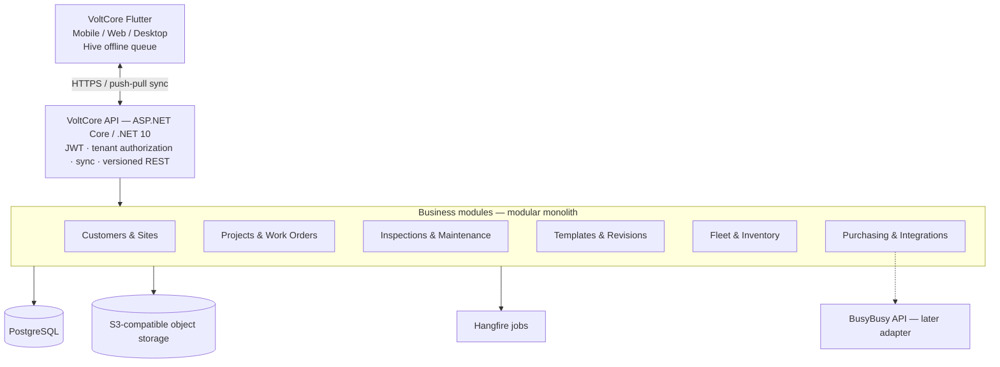
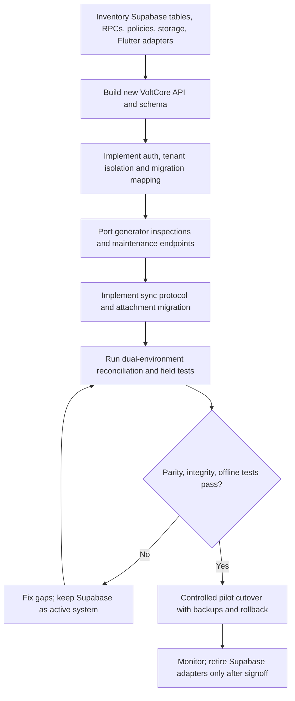
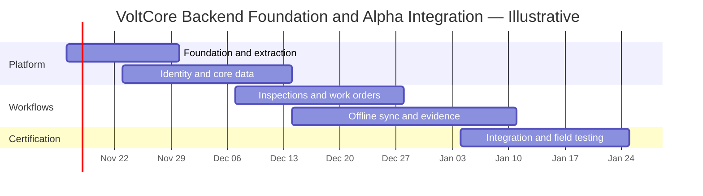

# VoltCore Backend: Tycoon Infrastructure Reuse, Removal, and Migration Plan

**Assessment date:** 2026-11-09  
**Source repository:** [devartblake/TycoonTycoon_Backend](https://github.com/devartblake/TycoonTycoon_Backend)  
**Target client:** [devartblake/volt_core](https://github.com/devartblake/volt_core)  
**Status:** Architecture recommendation; no code changes or extraction validated.

## Executive summary

**Reuse Tycoon's engineering foundation, not its entire application.** Build an independent `VoltCore.Backend` modular monolith using ASP.NET Core/.NET 10, PostgreSQL, EF Core, JWT authentication, tenant authorization, Hangfire, S3-compatible object storage, Docker, and structured telemetry. Exclude Synaptix gameplay, multiplayer, rewards, crypto/wallet, adaptive music, and most multi-service infrastructure. Keep Flutter/Hive offline-first capabilities, replacing Supabase remote adapters incrementally.

The source repository confirms these technologies and domain-specific features in its package manifest, API startup, Docker Compose configuration, and documentation. Presence in the repository does **not** establish that each subsystem is production-ready or independently reusable.

## 1. Retain, modify, remove, or defer

| Tycoon component | Decision | VoltCore use / rationale |
|---|---|---|
| ASP.NET Core / .NET 10 | **Keep** | Single deployable business API |
| PostgreSQL + EF Core | **Keep** | Transactional data and migrations; new VoltCore schema |
| JWT/authentication | **Modify** | Organization, tenant, user, contractor, assignment, role |
| Hangfire | **Keep, validate** | Reminders, overdue work, document processing, integration retries |
| MinIO / S3 storage abstraction | **Modify** | Tenant-private photos, signatures, PDF reports; Linode object storage in production |
| Docker Compose | **Simplify** | Single Linode production server and GitHub-hosted CI |
| Serilog / OpenTelemetry / health checks | **Keep, validate** | Logging, traces, service health, alerts |
| Redis | **Optional** | Add when performance or coordination warrants it |
| YARP API gateway | **Defer** | Not necessary for a single API |
| SignalR | **Optional** | Dispatch and work-order live updates |
| MongoDB | **Remove initially** | Use PostgreSQL for initial operational reporting |
| Elasticsearch / Kibana | **Remove initially** | PostgreSQL search sufficient for initial scope |
| RabbitMQ / MassTransit / Kafka | **Defer** | Reduce operational complexity; revisit with workload evidence |
| Game mechanics / matchmaking | **Remove** | No field-service relevance |
| XP, seasons, rewards, skill trees | **Remove** | Game-specific logic |
| Anti-cheat / player enforcement | **Replace** | Field audit trail, approvals, evidence integrity |
| Game wallets, cosmetics, store | **Remove** | Not equivalent to purchasing or invoicing |
| Music / adaptive audio | **Remove** | Product-specific |
| Game operator dashboards | **Replace** | Dispatch, purchasing, project management, admin screens |

**Important:** “Remove” means exclude from the **new VoltCore solution**; do not delete components from the active Synaptix/Tycoon repository.

## 2. Proposed Alpha architecture



**Architecture choice:** one deployable backend with internal module boundaries, not a direct copy of Tycoon's multi-service deployment. Split services only after scaling, ownership, or isolation requirements justify it.

## 3. Required architectural changes

### 3.1 Authentication, tenancy, and authorization

Retain security primitives, not game-specific identity assumptions. Model `Tenant`, `OrganizationMembership`, `User`, `Role`, `ProjectAssignment`, and resource ownership. Authorize every operation server-side. Flutter UI hiding is not access control. Apply tenant-aware queries and resource-level checks; test cross-tenant denial. Consider PostgreSQL RLS as defense in depth, not a substitute for API authorization.

| Role | Typical privileges |
|---|---|
| Platform administrator | Platform administration and controlled support access |
| Company administrator | Company membership, roles, settings |
| Project manager | Projects, approvals, schedules, work orders |
| Dispatcher | Assignments, scheduling, fleet dispatch |
| Technician | Assigned inspections, maintenance, field evidence |
| Purchasing agent | Stock, purchase orders, receiving, inventory ledger |
| Customer | Explicitly authorized site/report visibility |

**Existing VoltCore risk:** inventory restrictions described as client/UI-only must become server-enforced authorization before release.

### 3.2 Data and schema

Retain PostgreSQL and EF Core but start **fresh VoltCore migrations**. Core entities: tenants, memberships, customers, sites, assets/generators, projects, work orders, schedules, templates, immutable template revisions, responses, inspections, maintenance, fleet, inventory locations, stock ledger, purchase orders, attachments, approvals, and audit records. Preserve Supabase UUIDs or use an explicit mapping table; retain historical template revision and evidence relationships.

### 3.3 Offline-first synchronization

The largest migration risk is replacing Supabase data transport without damaging Hive offline workflows. Implement client-generated operation IDs, server-side idempotency, per-device cursors, record versions/ETags, optimistic concurrency, explicit conflict results, durable attachment-upload state, and immutable completed inspection records with controlled amendments. Avoid silently dropping stale changes or relying solely on last-write-wins. Test device restart, prolonged offline work, retries, concurrent edits, and replay.

### 3.4 Document and evidence storage

Adapt the S3-compatible storage abstraction, not Tycoon's game seed and asset workflows. Use private tenant-scoped object keys, server-authorized short-lived upload/download URLs, checksums, file metadata, retention controls, and auditable signatures. Linode Object Storage can replace running MinIO in production; MinIO may remain a local development substitute.

### 3.5 Background jobs

Use Hangfire for scheduled inspection reminders, overdue work orders, report generation, integration retry, and reconciliation. Verify actual storage, retry policy, dashboard access, and metrics: the repository's `HangfireMetricsCollector` identifies placeholder metrics. Do not assume monitoring is complete simply because dashboards exist.

### 3.6 BusyBusy integration

Create an isolated adapter with credentials, rate limits, idempotency, retries, mapping, and audit logs. Validate BusyBusy API permissions and specific endpoints before promising synchronization. QuickBooks remains deferred; Hilti OnTrack is out of current scope.

## 4. Proposed project structure

```text
VoltCore.Backend/
├── src/
│   ├── VoltCore.Api/
│   │   ├── Endpoints/
│   │   ├── Middleware/
│   │   └── Program.cs
│   ├── VoltCore.Application/
│   │   ├── Abstractions/
│   │   ├── Authorization/
│   │   └── Synchronization/
│   ├── VoltCore.Domain/
│   │   ├── Tenancy/
│   │   ├── Customers/
│   │   ├── Sites/
│   │   ├── Assets/
│   │   ├── WorkOrders/
│   │   ├── Inspections/
│   │   ├── Maintenance/
│   │   ├── Fleet/
│   │   ├── Inventory/
│   │   └── Purchasing/
│   ├── VoltCore.Infrastructure/
│   │   ├── Persistence/
│   │   ├── Identity/
│   │   ├── Storage/
│   │   ├── Jobs/
│   │   └── Integrations/
│   │       └── BusyBusy/
│   └── VoltCore.Contracts/
├── tests/
│   ├── Unit/
│   ├── Integration/
│   ├── Authorization/
│   └── Sync/
├── docker/
├── scripts/
├── docs/
└── .github/workflows/
```

The directory tree is **proposed**, not currently present in Tycoon. Start with four or five core projects and tests, rather than importing every Synaptix project.

## 5. Exclusions from the extracted backend

| Source feature or service | Action | Replacement / justification |
|---|---|---|
| Questions, matches, game sessions | Exclude | Inspection and work-order workflows |
| Rewards, XP, ranks, seasons | Exclude | No business requirement |
| Multiplayer and matchmaking | Exclude | Dispatch status does not require game sessions |
| Anti-cheat | Exclude | Audit, approval, tamper evidence |
| Adaptive music / render evidence | Exclude | No field-service purpose |
| Game wallet / Stripe store | Exclude for Alpha | Purchasing/invoicing is a separate domain |
| MongoDB analytics / crypto | Exclude | PostgreSQL initially |
| Elasticsearch / Kibana | Exclude | Postgres search initially |
| RabbitMQ / Kafka | Defer | Simpler jobs and transactions initially |
| React / Django operator dashboards | Exclude | Flutter already covers client platforms |
| Synaptix setup and game seed services | Rewrite | VoltCore-specific provisioning and migrations |

**Source-specific observation:** Tycoon's `Synaptix.Backend.Api/Program.cs` includes product-specific registrations, including adaptive music and compliance flows. Do not copy `Program.cs` wholesale. Its `docker/compose.yml` provisions PostgreSQL, MongoDB, Redis, Elasticsearch, RabbitMQ, MinIO, monitoring, and administration tools. This is more infrastructure than VoltCore Alpha needs.

## 6. Supabase replacement map

| Current Supabase responsibility | New VoltCore implementation |
|---|---|
| Supabase Auth | ASP.NET Core identity/session services + JWT |
| Hosted PostgreSQL | Independently managed PostgreSQL |
| Row-level security | Server-side authorization and tenant isolation, optional PostgreSQL RLS |
| RPC / database functions | Versioned REST endpoints + application services |
| Supabase Storage | Private S3-compatible object storage |
| Supabase Realtime | SignalR only if real-time dispatch is needed |
| Supabase client sync | Durable push/pull sync API and migration-compatible adapters |

### Incremental cutover chart



Never cut over solely because the new CRUD endpoints work; verify tenant authorization, offline replay, historical data, PDFs, signatures, and rollback.

## 7. Illustrative ten-week implementation chart

The following is a **planning scenario for four developers**, not a delivery commitment. Dependencies and parallel work can change the schedule. The broader Alpha/Beta estimate remains subject to field-pilot and data-migration findings.



| Workstream | Approximate weeks | Primary deliverable |
|---|---|---|
| Foundation and extraction | 1–2 | Buildable .NET solution, PostgreSQL, Docker, CI, health checks |
| Identity and core data | 2–4 | Tenancy, roles, schema, migrations |
| Inspections and work orders | 4–6 | First complete generator workflows |
| Offline sync and evidence | 5–8 | Push/pull protocol, conflicts, photos, PDFs |
| Integration and certification | 8–10 | A&S Electric field pilot, reconciliation, rollback test |

## 8. Security, deployment, and migration risks

1. **Tenant isolation:** Replace Supabase RLS with verified API authorization and database safeguards; test cross-tenant access attempts.
2. **Offline conflict handling:** Online CRUD success is not offline readiness. Verify replay, duplicates, edits from two devices, and completion locks.
3. **Historical data:** Preserve inspection revisions, signed reports, photo relationships, and IDs across migration.
4. **Infrastructure exposure:** Tycoon's development Compose publishes infrastructure ports and configures a development Traefik dashboard. Do not copy development network exposure to production; expose only HTTPS and keep databases/admin endpoints private.
5. **Dependency coupling:** Generic-looking Tycoon libraries may import game-specific types, startup registrations, or configuration. Inspect dependency graph and run build/tests after each extraction.
6. **Metrics placeholders:** Validate monitoring instrumentation and alert delivery before production.
7. **Operational recovery:** Implement encrypted backups, tested restores, migration rollback plans, secrets management, and deploy-once release provenance.
8. **Existing VoltCore gaps:** Server-enforce stock location permissions; reconcile inventory ledger reversals; make evidence portable; handle partial approval failures and stale sync conflicts.

## 9. First engineering PR — recommended scope

**Do not fork Tycoon and immediately delete folders.** Instead, create a new `VoltCore.Backend` solution and selectively port infrastructure patterns.

- [ ] Scaffold .NET 10 API, application, domain, infrastructure, contracts, and test projects.
- [ ] Port generic logging, exception handling, API versioning, OpenAPI, health checks, and configuration patterns.
- [ ] Add PostgreSQL and a fresh initial EF Core migration; avoid game tables.
- [ ] Implement tenant-aware JWT authentication and resource-level authorization.
- [ ] Add one end-to-end generator inspection API workflow.
- [ ] Implement idempotent sync operations and a Flutter adapter proof of concept.
- [ ] Add authorization, migration, API-contract, offline-replay, and integration tests.
- [ ] Provide local Docker Compose and a minimal Linode production configuration.
- [ ] Add GitHub-hosted CI for build, tests, migration verification, and container build.
- [ ] Document cutover gates, backups, rollback, and A&S Electric live-pilot acceptance criteria.

**Exit criteria:** independently deployable API; authenticated Flutter-to-PostgreSQL workflow; clean migrations; cross-tenant denial tests; offline replay tests; working evidence upload; observable health and errors. The first PR need not complete every domain.

## 10. Source references and evidence boundaries

These files were inspected or identified through GitHub repository search on 2026-11-09:

- [Tycoon README](https://github.com/devartblake/TycoonTycoon_Backend/blob/main/README.md) — confirms Synaptix gaming product focus.
- [Central package versions](https://github.com/devartblake/TycoonTycoon_Backend/blob/main/Directory.Packages.props) — .NET/EF/Npgsql, Hangfire, telemetry, JWT, SignalR, MinIO, MassTransit, YARP, Redis, MongoDB and search dependencies.
- [Backend API startup](https://github.com/devartblake/TycoonTycoon_Backend/blob/main/Synaptix.Backend.Api/Program.cs) — application registrations and Synaptix-specific coupling.
- [Docker Compose](https://github.com/devartblake/TycoonTycoon_Backend/blob/main/docker/compose.yml) — actual declared infrastructure services and development networking.
- [Hangfire metrics collector](https://github.com/devartblake/TycoonTycoon_Backend/blob/main/Synaptix.Monitoring/Jobs/HangfireMetricsCollector.cs) — placeholder metrics caveat.
- [MinIO setup](https://github.com/devartblake/TycoonTycoon_Backend/blob/main/docs/infrastructure/minio-setup.md) — object storage patterns.
- [PostgreSQL initialization](https://github.com/devartblake/TycoonTycoon_Backend/blob/main/docker/init/postgres/01-init.sh) — database provisioning example.

This is a **repository-level architecture and extraction assessment**, not a complete class-by-class dependency audit, full solution build, production security audit, or verified migration. No source repositories, branches, deployments, or data were changed.

## Final recommendation

Create an **independent VoltCore modular-monolith backend**. Reuse generic Tycoon engineering patterns selectively, exclude game-specific modules and unnecessary infrastructure, and prioritize generator inspections/maintenance with robust tenant isolation and offline synchronization. Establish the new backend alongside Supabase; cut over only after A&S Electric field certification, data reconciliation, and rollback validation.