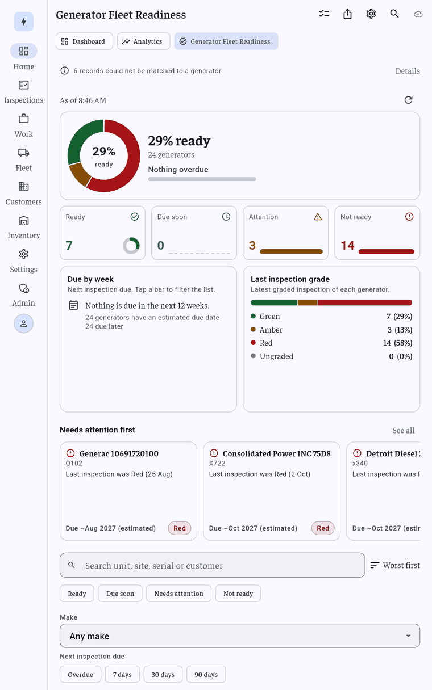
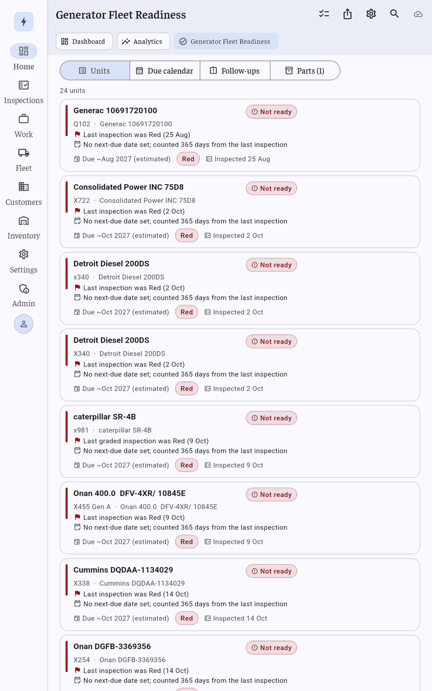

# Generator Fleet Readiness

The screen is named "Generator Fleet Readiness" everywhere the user sees it so it is not confused with the vehicle Fleet section. Route names and Dart identifiers still say `readiness`.

One screen of generators by next-service date, last inspection grade and open follow-ups (item 7 of [generator_management_research.md](generator_management_research.md)). The first half of this document is the data and rules layer in `lib/modules/readiness/` (stage 1); [The dashboard](#the-dashboard) describes the screens built on it (stage 2).

## Layout

| Path | What |
|---|---|
| `domain/readiness_models.dart` | `ReadinessUnit`, `ReadinessStatus`, `ReadinessReason`, `ReadinessGrade`, `ReadinessConfig`, `DueWeekBucket` |
| `domain/readiness_inputs.dart` | Plain input records and `ReadinessInputs` |
| `domain/readiness_join.dart` | Grouping records into units (serial, then site code) |
| `domain/readiness_rules.dart` | `computeReadiness(inputs, config, now)`: the one place the rules live |
| `domain/readiness_summary.dart` | `summarizeReadiness`, `ReadinessFilter`, `ReadinessSort`, `sortReadiness` |
| `domain/readiness_csv.dart` | `readinessCsv(units)` |
| `presenter/readiness_providers.dart` | Riverpod providers |

The domain files are pure Dart (no Flutter, no Hive). Tests are in `test/readiness/`.

## Data sources

| Source | Used for | Gaps |
|---|---|---|
| Inspections (`inspectionListControllerProvider`, `InspectionEntity`) | The units themselves; last inspection date, grade (`siteGrade`), `nextDueAt`, make/model/serial, fuel type, site code, address, load bank switch (`loadbankDone`) | No "finished/draft" status is stored; the finish rule is computed elsewhere from the parts lists, so every inspection counts here. No customer field (`customerName` is the signer). |
| Equipment registry (`equipmentListProvider`) | Adds registered but never inspected generators; fills fuel type; retires units | The registry is derived from inspections, so it adds little except manually registered assets. Fuel is only read from `metadata['fuelType']`. |
| Maintenance (`maintenanceRepoProvider.getAll()`, `MaintenanceRecord`) | Open follow-ups (`requiresFollowUp`, `followUpNotes`), open jobs for short parts | Read synchronously from Hive: not observed. `MaintenanceJobEntity` has no make/model/serial, so the Hive record is used. |
| Schedule (`scheduleControllerProvider`) | Next scheduled visit | Tasks carry a site code and optional inspection link, never a serial. |
| Load tests (`LoadTestRecord`, `TestIntervalRecord`) | Not used directly | Both are keyed by inspection id and hold no dates. The only load test date the app has is the service date of an inspection with `loadbankDone` on. `lastLoadTestAt` comes from that; `nextLoadTestDueAt` = last + `loadTestIntervalDays` (365). Informational only. No nameplate interval exists to read. |
| Parts needs (`jobNeedsProvider`) | `partsShortCount` | A job's short count is 0 until it has flagged parts. |
| Customer directory (`customerSiteDirectoryProvider`, Supabase) | Customer name and fallback address by site code | Needs an active tenant and a connection; skipped silently otherwise, so `customer` is then empty. |

Each source is loaded best effort in `readinessInputsProvider`: a failing source is skipped and the rest are used.

No district data exists. Borough is derived only from the site code prefix: `Q_` is Queens, `X_` is Bronx (case-insensitive). Any other code gives an empty borough.

## Unit identity and joins

A unit is one generator. Its `key` is:

1. `generatorProfileKey(make, model, serial)` when a serial is known (same key as the parts profile, so the UI can open the profile); `ReadinessUnit.profileKey` has it too;
2. else `site:<normalised site code>` for an inspection without a serial;
3. else `id:<inspection id>` (no serial and no site code).

Joining, in order:

1. **Inspections** with a serial (trimmed, case and spacing ignored; `n/a`, `none`, `-`, `unknown` and similar count as no serial) group by serial. A generator that moves site stays one unit; the newest inspection decides the shown site.
2. Inspections **without** a serial join the only unit at the same site code whose make/model do not contradict theirs; otherwise they form one site-level unit per site code.
3. **Registry equipment**: generators only, joined the same way (serial, then site + make/model). A registered generator that matches nothing becomes a unit with no inspection (so it shows as "No inspection on record"). If every registry row of a unit is retired the unit is left out.
4. **Maintenance**: by inspection link, else serial, else site code (+ make/model).
5. **Schedule tasks**: by inspection link (or `sourceId` of an inspection), by maintenance link, else site code.
6. **Parts needs**: through the inspection or maintenance id of the job.

A serial that matches no unit never falls back to the site code (it names a different machine). A site code that matches several units (and cannot be narrowed by make/model) is ambiguous.

**Records that match nothing, or are ambiguous, never create a unit and are never guessed.** They are counted in `ReadinessReport.unmatched` (`maintenance`, `tasks`, `jobNeeds`, plus `skippedEquipment` for non-generators). A screen can show "N records could not be matched".

## Rules

Definitions (local calendar days; today is the day of `now`):

* **Latest inspection**: the newest inspection dated on or before `now`. A future-dated one is a planned visit (it feeds the next scheduled visit) and not history.
* **lastGrade**: grade of the newest inspection that has a Green/Amber/Red grade. A later Green clears an earlier Red; a later ungraded inspection does not.
* **nextDueAt**: the latest inspection's own `nextDueAt`. If it has none: latest inspection date + `staleInspectionDays`, flagged `dueIsEstimated`.
* **daysToDue**: whole calendar days from today to `nextDueAt`; negative is overdue.
* **Open follow-up**: a maintenance record with `requiresFollowUp`, unless the unit has a completed maintenance record dated on a later day.
* **partsShortCount**: short lines on the latest inspection's parts list plus all not-completed maintenance jobs of the unit.

Status; the first row that matches wins, top to bottom:

| Status | When |
|---|---|
| Not ready | Never inspected |
| Not ready | Last grade is Red (no later Green) |
| Not ready | Overdue by more than `criticalOverdueDays` |
| Needs attention | Last grade is Amber |
| Needs attention | Overdue by 1 to `criticalOverdueDays` days (30 itself is here) |
| Needs attention | One or more open follow-ups |
| Needs attention | One or more short parts for its next job |
| Due soon | Due in 0 to `dueSoonDays` days (due today counts) |
| Ready | Everything else |

Info-only reasons that never change the status: visit scheduled, scheduled visit missed, estimated due date.

Thresholds (`ReadinessConfig`):

| Setting | Default | Stored | Meaning |
|---|---|---|---|
| `dueSoonDays` | 30 | `AppPreferencesService.readinessDueSoonDays` | Window for Due soon |
| `criticalOverdueDays` | 30 | `AppPreferencesService.readinessCriticalOverdueDays` | Overdue beyond this is Not ready |
| `staleInspectionDays` | 365 | not stored | Assumed interval when there is no next-due date |
| `loadTestIntervalDays` | 365 | not stored | Next load test = last + this |

Only an admin may save thresholds (`ReadinessConfigController.update(config, role: ...)` returns false for anyone else).

Reasons are plain text, worst first, for example: `Last inspection was Red (3 Oct)`, `Inspection overdue by 12 days`, `Due in 9 days`, `2 open follow-ups`, `No inspection on record`, `Parts short for next job (3 parts)`.

## API for the screens

Providers (`presenter/readiness_providers.dart`, all `autoDispose`, computed once per data or config change):

| Provider | Type |
|---|---|
| `readinessInputsProvider` | `FutureProvider<ReadinessInputs>` (the test seam) |
| `readinessReportProvider` | `FutureProvider<ReadinessReport>` (`units`, `unmatched`, `now`, `config`) |
| `readinessUnitsProvider` | `Provider<AsyncValue<List<ReadinessUnit>>>`, worst first |
| `readinessSummaryProvider` | `Provider<AsyncValue<ReadinessSummary>>` |
| `readinessConfigProvider` | `StateNotifierProvider<ReadinessConfigController, ReadinessConfig>` |
| `readinessFilterProvider` | `StateProvider<ReadinessFilter>` |
| `readinessSortProvider` | `StateProvider<ReadinessSort>` |
| `filteredReadinessUnitsProvider` | `Provider<AsyncValue<List<ReadinessUnit>>>` (filtered, then sorted) |
| `readinessClockProvider`, `readinessConfigStoreProvider` | overridable in tests |

Pure functions: `computeReadiness`, `summarizeReadiness(units, now, {worstCount, weeks})`, `sortReadiness`, `ReadinessFilter.apply`, `distinctMakes`, `distinctBoroughs`, `readinessCsv`, `canEditReadinessConfig(role)`.

Refresh: the inspection list and schedule are watched, so they refresh the dashboard. Maintenance is read straight from Hive and is not observed; call `ref.invalidate(readinessInputsProvider)` on pull-to-refresh.

Summary fields: `total`, `counts` / `count(status)`, `percentReady` (0 to 100; 0 for an empty fleet), `overdueCount`, `dueSoonCount`, `gradeCounts`, `dueByWeek` (12 buckets, Monday start, first = this week, overdue units not included), `dueLater`, `worstUnits`, `followUpCount`, `partsShortUnits`.

CSV: header row, every text field quoted, CRLF rows, `yyyy-MM-dd` dates; text starting with `= + - @` gets a leading apostrophe so spreadsheets do not run it as a formula.

## The dashboard

*Screenshots from the test tablet (portrait, light theme).*

Stage 2. Route `/readiness` (`RouteNames.readiness`), tab **Generator Fleet Readiness** in the Home section beside Dashboard and Analytics, visible to every role.

### Files

| Path | What |
|---|---|
| `presenter/pages/readiness_page.dart` | The screen: state, refresh, selection, two-pane layout |
| `presenter/widgets/readiness_overview.dart` | As-of line, hero, status tiles, Due by week and grade cards |
| `presenter/widgets/readiness_stat_tile.dart`, `readiness_mini_charts.dart` | A status tile and its graph; `MiniRing`, `MiniBarStrip`, `MiniStackBar` (`CustomPainter`, one Semantics label each) |
| `presenter/widgets/readiness_attention_row.dart` | "Needs attention first" as a row of unit cards with "See all" |
| `domain/readiness_mini_series.dart` | Pure series for the tile graphs: reason counts per status, due-soon week slice, shares |
| `presenter/widgets/readiness_charts.dart` | `ReadinessDonut`, `DueByWeekChart`, `GradeBar`, `GradeTrendStrip` (all `CustomPainter` or plain boxes, no chart package) |
| `presenter/widgets/readiness_filters.dart` | Search, status chips, sort, make / borough / due / grade / follow-up filters, the phone "Filters" sheet |
| `presenter/widgets/readiness_segments.dart` | Units / Due calendar / Follow-ups / Parts rows |
| `presenter/widgets/readiness_unit_card.dart`, `readiness_unit_detail.dart` | A unit row, and the detail (sheet or side pane) |
| `presenter/widgets/readiness_bulk.dart` | Selection bar and bulk scheduling |
| `presenter/widgets/readiness_settings_sheet.dart`, `readiness_notices.dart` | Admin thresholds; error banner and "records not matched" note |
| `presenter/readiness_services.dart` | `readinessSchedulerProvider`, `readinessExporterProvider` (test seams), `canScheduleReadiness` |
| `domain/readiness_view.dart` | Wording ("Due in 9 days"), `groupByDueWeek`, `inspectionHistoryFor`, filter counts |
| `domain/readiness_export_data.dart`, `lib/core/services/pdf/readiness_report_pdf.dart` | Input and layout of the PDF |

### What each part shows

* **Overview**, top to bottom:
  1. "As of 3:20 PM" with a refresh button.
  2. The hero: "N% ready" with the unit count, the overdue count and a thin overdue-versus-fleet bar, beside the status donut (centre = percent ready; one spoken sentence for screen readers).
  3. Four status tiles (Ready, Due soon, Attention, Not ready) that are also filters. Each has a small graph next to its count: **Ready** a ring of its share of the fleet; **Due soon** twelve mini bars of units due per week for the next 12 weeks, only the weeks inside the due-soon window in the status colour; **Attention** a stacked bar of its reasons (Amber grade, Overdue, Follow-ups, Parts short); **Not ready** a stacked bar of Red grade, Long overdue and Never inspected. A unit with two reasons counts under both, so a bar can add up to more than the tile's number; the Semantics label lists the counts. All-zero data draws an empty track. The series come from `domain/readiness_mini_series.dart` (`attentionReasonCounts`, `notReadyReasonCounts`, `dueSoonWeekSlice`, `statusShare`), fed from the summary and the units.
  4. One row with two equal cards from 600 dp wide, stacked on phones: **Due by week** (12-week bars with an Overdue bar first, Monday weeks; tap a bar to filter the list to that week, tap again to clear; narrow phones drop the value labels) and **Last inspection grade** (stacked bar plus a Green / Amber / Red / Ungraded list with counts and shares). When no unit has an overdue or in-range due date the bar chart is replaced by a note ("No next-inspection dates set yet. Due dates shown are estimates.", or "Nothing is due in the next 12 weeks." when some are later) with the number of generators using an estimated due date.
  5. **Needs attention first**, full width under that row: the five worst units as compact cards (status icon, title, site and customer, first reason, due text, grade chip, 280 dp wide), with a "See all" action that applies the Not ready filter. When all five fit (5 x 280 dp plus gaps) they fill the row; otherwise the row scrolls sideways. On this page the body is at most 1400 dp (less beside the 440 dp detail pane), so in practice it scrolls sideways except on very wide hosts.
* **Filters and sort.** Search (title, site, address, serial, customer), status chips (multi-select), make, borough chips (only when some site code gives a borough), due window (Overdue, 7, 30, 90 days) or one chosen week, last grade, "Has follow-ups", and a sort menu (Worst first, Next due, Last inspected, Name). A count of active filters with "Clear all". Below 600 px the less-used filters sit behind a "Filters (n)" sheet. The filters and the sort live in providers that are not auto-disposed, so they are remembered while the app runs (not across restarts). Saved presets are not built.
* **Segments.** *Units* (the filtered list, built lazily), *Due calendar* (Overdue, This week, Next week, "Week of 23 Nov"... to 12 weeks, Later, No due date, with counts), *Follow-ups* (open notes, newest first), *Parts* (units short of parts, with a link to the Shortages page and to the unit's parts profile). All four honour the filters.
* **Unit card.** Status chip, the top two reasons, the due countdown ("Due in 9 days", "Overdue 12 days", "Due ~Mar 2027 (estimated)"), last grade and date, site, customer, make and model.
* **Unit detail.** A bottom sheet on phones and portrait tablets; a right-hand pane (440 px) when the page body is 900 px or wider. All reasons with icons by kind and colour by severity, key facts (site, make / model, serial, fuel, last inspection, last grade, last and estimated next load test, next due, next scheduled visit), the unit's inspection history with a grade-dot trend, open follow-ups, short parts, and the actions below.
* **States.** Skeleton while loading; "No generators yet" (says readiness comes from inspections and registered generators); "No units match these filters" with Clear filters; an error with no data offers Retry; a failed refresh keeps the last data under an error banner; "N records could not be matched to a generator" opens a sheet that counts them by kind. It works from device data, so it is usable offline. Pull-to-refresh (and the refresh button) invalidate `readinessInputsProvider`, because maintenance is read straight from Hive.

### Who can do what

| Action | Technician | Dispatcher | Supervisor | Admin |
|---|---|---|---|---|
| View, filter, search, open units, export, select units | yes | yes | yes | yes |
| Schedule inspection (one unit), Create maintenance job, bulk "Schedule inspections" | no | yes | yes | yes |
| Generator fleet readiness settings (gear) | no | no | no | yes |

`canScheduleReadiness(role)` and `canEditReadinessConfig(role)` decide this. The main Dashboard shows a "Generator fleet readiness 87% ready" tile and a critical "N generators not ready" line (opens `/readiness?status=notReady`) to dispatchers, supervisors and admins only (`buildAttention`, `fleetReadinessValue`).

### Scheduling

"Schedule inspection" asks for a date and calls `ReadinessScheduler.scheduleInspection`. The real implementation builds a `TaskScheduleEntity` (source type `inspection`, linked by `inspectionId` and `sourceId` to the unit's latest inspection, site code and address filled, status `scheduled`, 8:00 on the chosen day) and saves it with `ScheduleRepository.saveTask`, the same call the Schedule screen's new-task dialog uses (local save, cloud sync queue, reminder). Then it reloads the schedule list and invalidates the readiness inputs, so the unit's "next scheduled visit" updates. A unit with no inspection falls back to its site code. Bulk scheduling does the same for every selected unit with one date; a failure on one unit does not stop the others and the failures are listed ("Scheduled 4 of 6 inspections"). "Create maintenance job" uses the existing `scheduleMaintenanceFromInspection` on the unit's latest inspection (it opens that flow's own date picker and the work-order editor).

### Bulk selection

Long-press a card, or use the checklist button in the app bar. The bottom bar offers "Select all overdue", "Schedule inspections" (not shown to technicians) and "Export selected".

### Exports

Both go through `runUserAction` (busy and error handling; cancelled shows nothing) and respect the current filters, or the selection when there is one; the menu says "Export CSV (14 units)".

* **CSV**: `readinessCsv` (file `generator-fleet-readiness-<date>.csv`), shared with the system share sheet (a UTF-8 byte order mark is added so Excel reads it).
* **PDF "Generator Fleet Readiness Report"**: `PdfService.generateReadinessPdf`. Page one has the company header, the fleet numbers (percent ready, a count per status, overdue, follow-ups, parts, grades) and the 12-week due table; then the listed units grouped Not ready / Needs attention / Due soon / Ready, with their reasons; branded footer with "Page X of Y". It is saved under `<pdfs>/AandSElectric/PDFs/readiness/Generator_Fleet_Readiness_Report_<date>_<hhmm>.pdf` (reports saved earlier as `Fleet_Readiness_Report_*.pdf` stay in the same folder and still list under Other), queued for cloud backup like the other reports, and then shared. The Documents hub lists it under **Other** (it has no category of its own, so the type filters are unchanged).

### Thresholds

The gear (admins only) opens a sheet to change `dueSoonDays` ("Due soon window") and `criticalOverdueDays` ("Not ready when overdue by more than"), with a plain-words explanation and a live preview computed with `computeReadiness` ("At 45 days, 12 units would be Due soon"). Saving goes through `ReadinessConfigController.update(role: ...)`.

### Tests

`test/readiness/ui/` (widget tests with in-memory data: overview numbers and semantics, filters, segments, unit sheet and two-pane layout, role gating, bulk and single scheduling with a fake scheduler, CSV / PDF failure and cancel, thresholds, states, laziness, and a 1.3x no-overflow matrix on 360x800, 800x1280 and 1280x800 in light and dark), `test/readiness/ui/readiness_overview_layout_test.dart` (row layout, empty due chart, tile graph semantics, 1.3x matrix), `test/readiness/readiness_mini_series_test.dart`, `test/app/section_tabs_scroll_test.dart` (the long tab name scrolls the section tabs at 360 dp), `test/readiness/readiness_view_test.dart`, `readiness_services_test.dart` (scheduler, bulk, PDF bytes) and `test/dashboard/fleet_readiness_attention_test.dart`.
